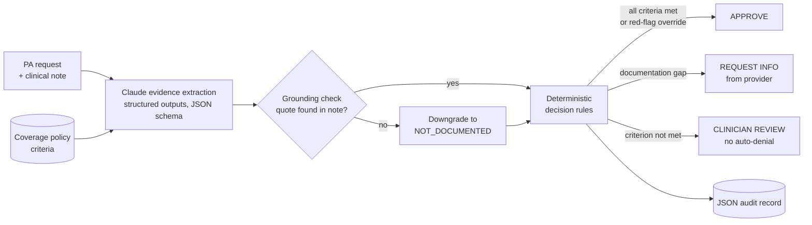

# Prior Authorization Decision Engine (Claude demo)

A small, working reference design for **LLM-assisted prior authorization** in health insurance.
Claude reads the clinical note and extracts evidence against each coverage criterion; plain, auditable
rules make the decision; and **the system never auto-denies**: anything that looks like a denial is
routed to a licensed clinician.

> All policies, members, providers and clinical notes in this repo are **synthetic**. The coverage
> policies are simplified illustrations, not real medical policy.

## Why this design

Prior authorization is a high-volume, high-stakes workflow. In production at a large payer, the
pattern that earns trust from clinicians, compliance and regulators is:

1. **LLM for reading, code for deciding.** The model's job is evidence extraction: messy notes in,
   structured findings out. The coverage decision is deterministic code anyone can audit.
2. **Every claim cites the chart.** Each finding must quote the note verbatim. A guardrail checks the
   quote exists; if not, the finding is downgraded to "not documented" so it can never drive an approval.
3. **Automate the yes, route the no.** Clear approvals are automated for speed; missing information
   triggers a request to the provider; potential denials go to a clinician.
4. **Evals before rollout.** A gold-labeled test set measures accuracy and, above all, **unsafe
   approvals**: the number that has to be zero before anything ships.



## What's in the repo

| Path | What it does |
| --- | --- |
| `data/policies.json` | 3 illustrative policies: lumbar MRI, GLP-1 for weight management, total knee replacement |
| `data/requests.jsonl` | 12 synthetic requests with gold labels per criterion and per decision (generated by `data/make_cases.py`) |
| `pa_engine/extractors.py` | `ClaudeExtractor` (Anthropic SDK, structured outputs) and `KeywordExtractor` (regex baseline) |
| `pa_engine/decision.py` | The decision rules, about 20 lines of auditable code |
| `pa_engine/engine.py` | Orchestration plus a JSON audit record per request |
| `eval/run_eval.py` | Accuracy, unsafe approvals, missed approvals, ungrounded evidence |
| `tests/` | Unit tests with a mocked Claude client (no API key needed) |

## Quick start

```bash
git clone https://github.com/<your-username>/prior-auth-decision-engine.git
cd prior-auth-decision-engine
python -m venv .venv && source .venv/bin/activate      # Windows: .venv\Scripts\activate
pip install -r requirements.txt

# Runs offline, no API key: the keyword baseline
python -m pa_engine.cli --all --offline
python -m eval.run_eval --extractor keyword

# With Claude: set your API key first
export ANTHROPIC_API_KEY=sk-ant-...                     # macOS / Linux
# $env:ANTHROPIC_API_KEY = "sk-ant-..."                 # Windows PowerShell
python -m pa_engine.cli PA-2002 PA-2003
python -m eval.run_eval --extractor claude

pytest -q
```

Set `PA_MODEL` to try a different model (default `claude-sonnet-5-5`).

## Results

The test set is deliberately small but tricky: negation ("no hypertension"), family history
("mother was diagnosed with medullary thyroid carcinoma"), timing ("started 2 weeks ago"), and
therapy that was ordered but never done.

| Extractor | Decision accuracy | Criterion accuracy | Unsafe approvals |
| --- | --- | --- | --- |
| Keyword baseline | 83% | 82% | **1** |
| Claude (`claude-sonnet-5-5`) | _run `python -m eval.run_eval --extractor claude`_ | | |

The baseline's unsafe approval is PA-2002: the note says *"BMI 28.1, **no** hypertension, diabetes,
dyslipidemia or sleep apnea"*, and keyword matching reads the comorbidities as present. Full
per-case results are written to `eval/results/`.

## Example output

Expected output for one case (run it yourself to see Claude's actual quotes and rationales):

```
PA-2003  GLP1-WM-01  ->  [CLINICIAN REVIEW]
  Reason: Required criterion not met: NO_MTC_MEN2
    - BMI_THRESHOLD          MET             "BMI 37 and type 2 diabetes"
    - LIFESTYLE_PROGRAM      MET             "Completed a 6-month lifestyle program"
    - NO_MTC_MEN2            NOT_MET         "Mother was diagnosed with medullary thyroid carcinoma"
```

## Taking this toward production

What a real deployment would add, roughly in order:

- **Integration:** FHIR-based intake (aligned with the CMS prior-authorization API requirements),
  utilization-management system write-back, and member and provider notifications.
- **Retrieval:** pull the relevant policy version and the full chart (labs, imaging reports) rather than a single note.
- **Evals at scale:** hundreds of clinician-labeled cases per policy, criterion-level error analysis,
  and regression runs on every prompt or model change.
- **Governance:** model risk review, PHI handling and zero-data-retention terms, bias monitoring
  across member groups, and human oversight metrics such as clinician override rates.
- **Monitoring:** drift in approval rates by policy and provider, latency, and cost per review.

## License

MIT
